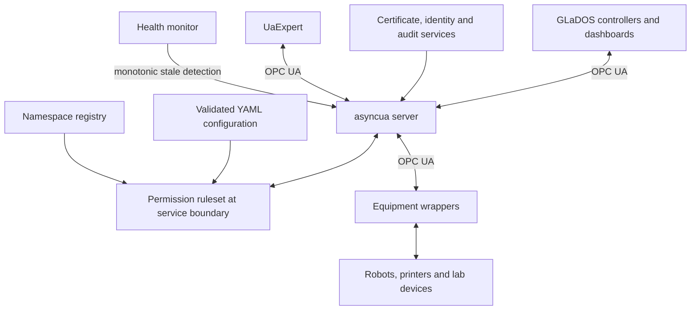

# Architecture

The server is an in-memory communication layer. It is not a controller and not
a safety system. Physical interlocks, emergency stops, limits and motion
validation remain in equipment wrappers and independent safety-rated systems.

## Startup order

1. Load and validate YAML (Pydantic, cross-reference checks, profile rules).
2. Initialise `asyncua`, set endpoint, server name and application URI.
3. Configure certificate, policies, identity tokens, user manager, ruleset.
4. Write and verify the exact NamespaceArray.
5. Create 18 objects and 488 variables from the manifest.
6. Start the additive health monitor and audit callback.
7. Listen; wait for SIGINT/SIGTERM.
8. Stop health and audit, then stop the server.

Any failure before step 7 aborts startup; the process never serves a partially
validated address space.

## Responsibilities

| Module | Responsibility |
|---|---|
| `models.py` | The configuration contract: NodeIDs, types, defaults, ownership. |
| `validation.py` | Loading, cross-references, duplicate detection, fail-fast. |
| `namespaces.py` | Exact NamespaceArray and reserved gap placeholders. |
| `node_factory.py` | Typed node creation; explicit ValueRank/access behaviour. |
| `equipment_registry.py` | Built nodes and NodeId → equipment ownership. |
| `permissions.py` | Role matrix + `asyncua` service-boundary ruleset. |
| `security.py` | Certificates, expiry, identity tokens, credential checks. |
| `health.py` | Additive health namespace, PreWrite activity, stale detection. |
| `audit.py` | PostWrite audit lines without values. |
| `docs.py` | Deterministic generated reference page. |
| `legacy_parser.py` | AST extraction of the archived legacy source. |

## Frozen interface

The contract is the runtime manifest in `tests/fixtures/legacy_nodes.json`:

- 18 objects, 488 variables, 482 writable, 6 intentionally read-only.
- Exact NodeIDs including punctuation (`R1d_Joi1;` vs `LabCount`).
- Browse names in namespace 0 for variables and in the object namespace for objects.
- Exact UA data types, including four Int64 variables created from bare ints.
- Exact defaults, including `ByteString(00000000)` and legacy string sentinels.
- Object IDs `ns=<index>;i=1` (Operator is `ns=1;i=2001`).
- References and browse paths.

Namespace indexes 0–53 are preserved. The NamespaceArray additionally registers
stable URIs for indexes 2–53 and fills gaps with
`urn:glados:opcua:reserved:<index>`. This is additive: clients addressing by
numeric index are unaffected.

## Security boundary

Production enforcement happens in `GladosPermissionRuleset.check_validity`,
called by `asyncua` before a service executes. It decodes the request body from a
shadow copy of the stream and rejects the whole request if any NodeId is not
authorized. This covers writes (including batched writes), reads, monitored-item
creation, method calls and address-space management. Node `AccessLevel` remains
the legacy-compatible layer; the ruleset adds per-user, per-equipment ownership.

Anonymous/NoSecurity and password-less access exist only in the explicit
`legacy` profile, which refuses to start unless
`security.allow_insecure_legacy: true` is set.

## Health model

Health nodes are additive and live outside the legacy namespaces. Activity is
observed through the public PreWrite callback; timing uses `time.monotonic` and
published timestamps use UTC. Availability starts as `Unknown`, becomes
`Online` after an authorized write and `Stale` after the configured timeout.
Stale data is never reported as valid, and commands are never persisted or
replayed.

## Non-goals

C/open62541 migration, historical databases, web administration, REST/GraphQL,
MQTT, Kubernetes, redundancy, automatic equipment discovery and command replay.
